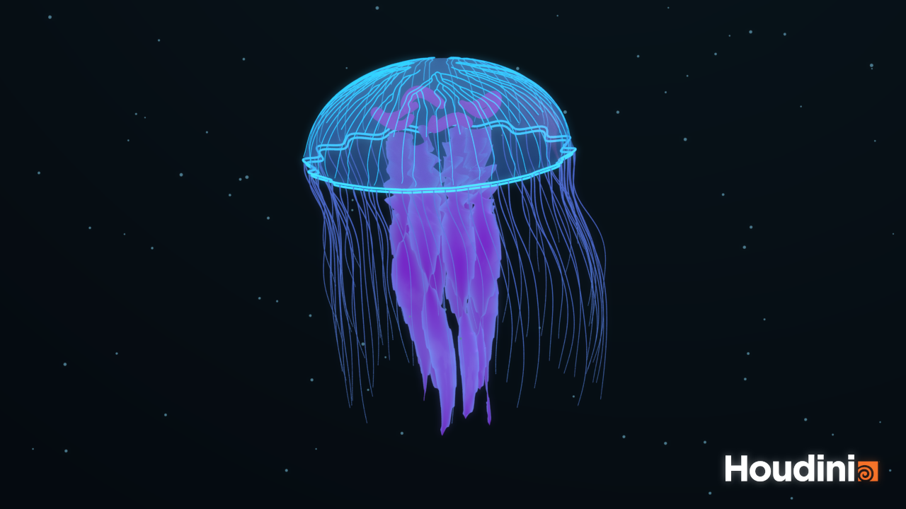
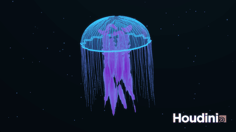
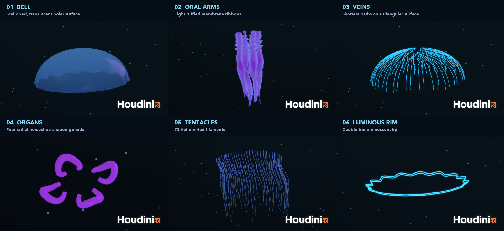
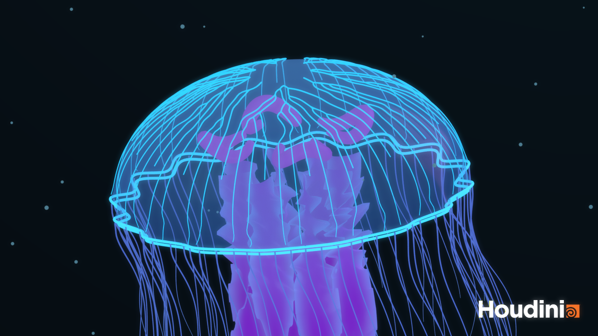

# HW03 Procedural Jellyfish

A cyber jellyfish suspended in a dark ocean.

## Animation

**[animation video](media/lucent.mp4)**

The GIF provides a preview.

## Procedural construction

| Part          | Implementation                                               |
| ------------- | ------------------------------------------------------------ |
| **Bell**      | A polar quad surface with an open underside, a rounded crown, and a 16-lobed scalloped lip. A time-dependent contraction varies across the surface and includes a gentle swimming translation. |
| **Oral arms** | Eight independent quad ribbons with seeded length variation, taper, twist, and folded edges. Point Deform transfers the bell motion, followed by a delayed sway that grows toward each tip. |
| **Veins**     | The rest bell is remeshed into isotropic triangles. Find Shortest Path connects 64 targets to eight crown roots. Resample, Fuse, and Smooth soften the paths; Sweep creates tapered tubes; Point Deform attaches them to the animated bell. |
| **Organs**    | Four radial horseshoe-shaped curves are swept into rounded gonads and animated with the same pulse as the bell. They remain visible through the outer membrane. |
| **Tentacles** | 72 seeded curves are configured as Vellum Hair. The first two points of each curve follow animated root targets. Reduced gravity, drag, and a varying current produce trailing motion. The simulated curves are resampled and swept into tapered filaments. |

## Additional detail and presentation

- Scalloped bell edges and a double luminous lip.
- Separate translucent, violet, and cyan emissive materials.
- A deep-sea gradient, suspended particles, three area lights.

